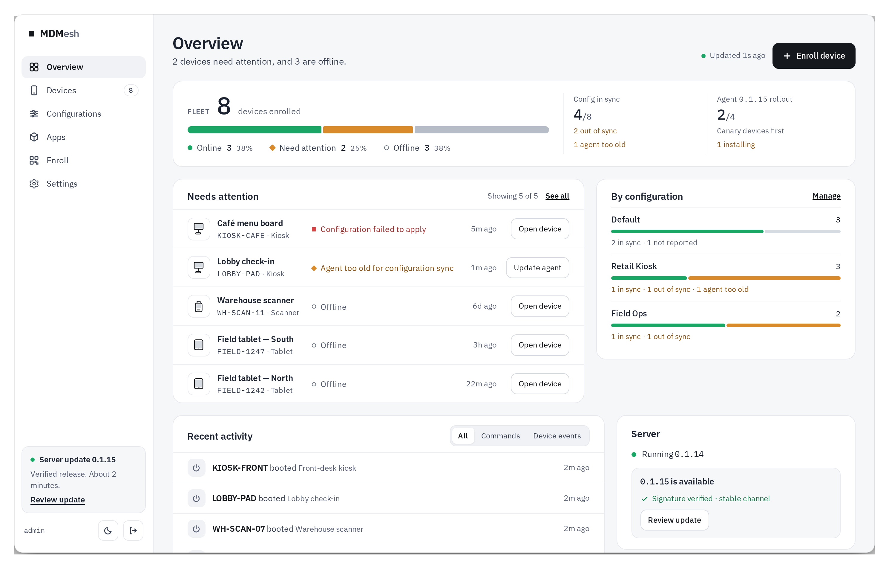
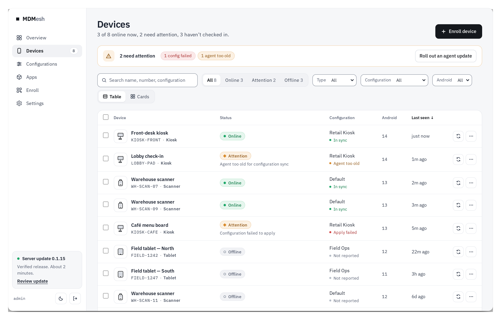
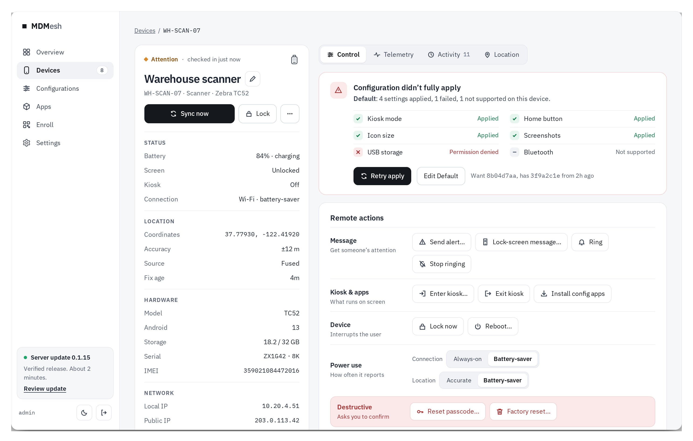
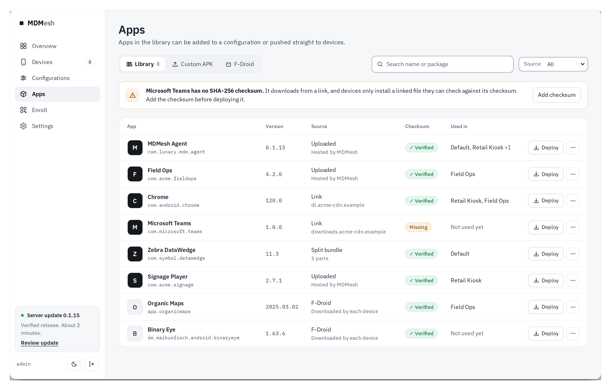
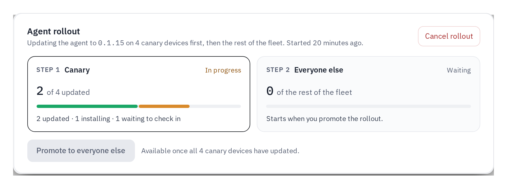

<div align="center">

# ◧ MDMesh

**A modern, self-hosted Android MDM** — fleet control, kiosk, app delivery, and
signed auto-updates, with a console that doesn't feel like 2012.

[](https://github.com/MDMesh-app/MDMesh/releases)
[](LICENSE)
[](CONTRIBUTING.md)


[Quick start](#-quick-start) · [Features](#-features) · [Full setup](DEPLOY.md) · [Architecture](STRUCTURE.md) · [Contributing](CONTRIBUTING.md) · [Roadmap](#-roadmap)

<br/>



<sub><i>The MDMesh console — overview (shown with sample data).</i></sub>

</div>

---

## What is MDMesh?

MDMesh is an open-source **Mobile Device Management** platform for Android. Enroll devices as Device Owner with
a QR code, then manage them from a web console: push apps, lock devices into kiosk mode, track location, run remote
actions, and keep server **and** agent updated with **signed releases that roll back on failure**.

It began as a fork of [Headwind MDM](https://h-mdm.com) and is being rebuilt as a distinct product in four planes:

| Plane | What it is | Stack |
|------|------------|-------|
| **Control plane** | The MDM server / REST API | Java · Jersey · Guice · MyBatis · PostgreSQL |
| **Admin console** | The modern web UI in this README | React · TypeScript · Vite |
| **Device agent** | A from-scratch Device-Owner app | Kotlin · coroutines · WorkManager |
| **Edge + updates** | TLS edge, tunnel, signed updater/recovery | Caddy · Cloudflare Tunnel · minisign |

### Our goal

> A **genuinely complete, modern** open-source MDM, with no paywalled "enterprise edition". Kiosk, app delivery,
> location, one-command deployment and signed auto-updates are all in the open-source core. A versioned,
> capability-negotiated agent protocol keeps old agents working across server updates.

---

## ✨ Features

<table>
<tr>
<td width="33%" valign="top">

**🛰 Fleet management**
Groups, configurations, live status, and a fast device list with search + filters.

</td>
<td width="33%" valign="top">

**🔒 Kiosk / COSU**
Single-app or multi-app lock-task with a custom home launcher and a crash-loop guard.

</td>
<td width="33%" valign="top">

**📦 App delivery**
A library + custom-APK upload + F-Droid, silent install/upgrade, and a deploy flow.

</td>
</tr>
<tr>
<td width="33%" valign="top">

**📍 Location**
Passive or active tracking, history trail, and a Leaflet map on the device page.

</td>
<td width="33%" valign="top">

**🔌 Reliable connectivity**
Instant wake channel when charging, battery-aware otherwise; survives reboots + self-updates.

</td>
<td width="33%" valign="top">

**♻️ Signed auto-update**
One-click or unattended server updates with DB backup + auto-rollback on quick-start installs, plus a recovery page.

</td>
</tr>
</table>

<details>
<summary><b>Full feature list</b></summary>

- **Enrollment** — QR-code Device-Owner provisioning. One signed APK serves every deployment; the server URL comes
  in the QR.
- **Modern console** — dark/light themes, keyboard-friendly and responsive.
- **Remote actions** — message, alert, ring, lock, reboot, passcode reset, wipe, power and location modes. All are
  capability-gated, so old agents never get a command they can't run.
- **Kiosk** — COSU lock-task, home-screen replacement, per-app "Show in kiosk", themed app grid, crash-loop
  protection.
- **App management** — APK upload, F-Droid catalog, silent install/upgrade from your server or any HTTPS host,
  with version and downgrade gating.
- **Telemetry** — battery, storage, network, Android version, Device-Owner status and an event timeline.
- **Deployment** — one `./setup.sh`: Docker Compose with auto-HTTPS (Caddy) or a Cloudflare Tunnel, or a native
  installer.
- **Signed auto-update** — CI signs every release (Ed25519/minisign) and deployments verify it. Quick-start installs
  update themselves with a database backup and automatic rollback; other installs show the command to run. A
  separate recovery service survives a bad update.
- **Staged device rollout** — new agent APKs go to a **canary** set, then **the fleet**.
- **Backward compatibility** — the `/agent/v1` contract is additive-only, checked by a golden test in CI.
- **Desired-state configuration** — devices converge to their saved configuration at the next check-in, with
  per-field sync status in the console. It enforces 24 fields, from kiosk options to Wi-Fi, factory reset and app installs.

</details>

---

## 📸 The console

<div align="center">

<br/>
<sub><i>Devices — the fleet at a glance.</i></sub>

<br/><br/>

<br/>
<sub><i>Device detail — status, location, hardware and remote actions.</i></sub>

<br/><br/>

<br/>
<sub><i>Apps — library, custom APKs and F-Droid.</i></sub>

<br/><br/>

<br/>
<sub><i>Staged canary → fleet agent rollout.</i></sub>

</div>

> Screenshots show the real console with representative sample data
> ([how to regenerate them](CONTRIBUTING.md#regenerating-the-docs-screenshots)).

---

## 🚀 Quick start

**Requirements:** a Linux host with Docker, Docker Compose v2, `openssl` and `curl`.

**One line, no clone** (pulls the released GHCR images; private ones need `docker login ghcr.io` first):

```bash
bash <(curl -fsSL https://raw.githubusercontent.com/MDMesh-app/MDMesh/main/quickstart.sh)
```

**From source** (clone + build):

```bash
git clone https://github.com/MDMesh-app/MDMesh.git
cd MDMesh
./setup.sh           # interactive: Cloudflare Tunnel, or your own HTTPS domain
```

**No Docker** ([native install](DEPLOY.md#option-c--native-no-docker): Debian 12/13 or Ubuntu 24.04, needs only `git`),
from the clone: `sudo ./setup.sh --native`

Each installer prints the console URL and a temporary admin password. Then enroll a device:

1. Sign in to the console and **set your own password**.
2. Go to **Enroll** and generate a QR code.
3. **Factory-reset** an Android device and tap the welcome screen 6× to open the QR scanner (or use
   `adb shell dpm set-device-owner` for a dev device).
4. Scan the QR. The device enrolls as Device Owner and checks in.

Hosting modes, the native install and everything else: **[DEPLOY.md](DEPLOY.md)**.

---

## 🧭 Where to go next

| I want to… | Read |
|------------|------|
| Install it | **[DEPLOY.md](DEPLOY.md)** |
| Update, roll back or recover | **[docs/UPGRADING.md](docs/UPGRADING.md)** |
| Configure, monitor, back up or uninstall it | **[docs/OPERATIONS.md](docs/OPERATIONS.md)** |
| Understand the codebase | **[STRUCTURE.md](STRUCTURE.md)** + [docs/adr](docs/adr) |
| Contribute | **[CONTRIBUTING.md](CONTRIBUTING.md)** |
| Set up a dev environment | [docs/DEV.md](docs/DEV.md) |
| Cut and sign a release | [RELEASING.md](RELEASING.md) |
| Read about the agent internals | [docs/agent-architecture.md](docs/agent-architecture.md) |

---

## 🗺 Roadmap

- ✅ Modern React + TypeScript console
- ✅ From-scratch Kotlin Device-Owner agent
- ✅ Kiosk / COSU + custom launcher
- ✅ App catalog + silent deploy
- ✅ Location tracking + history + map
- ✅ Reliable always-on connectivity
- ✅ One-command deployment (Docker or native)
- ✅ Signed releases, server auto-update with rollback, recovery page
- ✅ Staged canary → fleet agent-APK rollout
- 🔜 **Live remote control** (screen view + input, WebRTC + self-hosted TURN)
- 🔭 OEM-privileged tier (Knox / Zebra adapters) — parked behind the capability layer

---

## 🤝 Contributing

Code, docs, bug reports and ideas are all welcome. Start with **[CONTRIBUTING.md](CONTRIBUTING.md)**.

- **🐞 Found a bug?** Open a [bug report](https://github.com/MDMesh-app/MDMesh/issues/new?template=bug_report.yml).
- **💡 Have an idea?** Open a [feature request](https://github.com/MDMesh-app/MDMesh/issues/new?template=feature_request.yml).
- **🔧 Sending a PR?** Follow the [PR template](.github/pull_request_template.md); small, focused PRs merge fastest.

---

## 📜 License & credits

MDMesh is licensed under the **[Apache License 2.0](LICENSE)**.

It is a fork of **[Headwind MDM](https://h-mdm.com)** by Headwind Solutions LLC, also Apache-2.0
([why and how: ADR-0008](docs/adr/0008-licensing-and-rebrand.md)). Trademarks and brand names belong to their owners.
