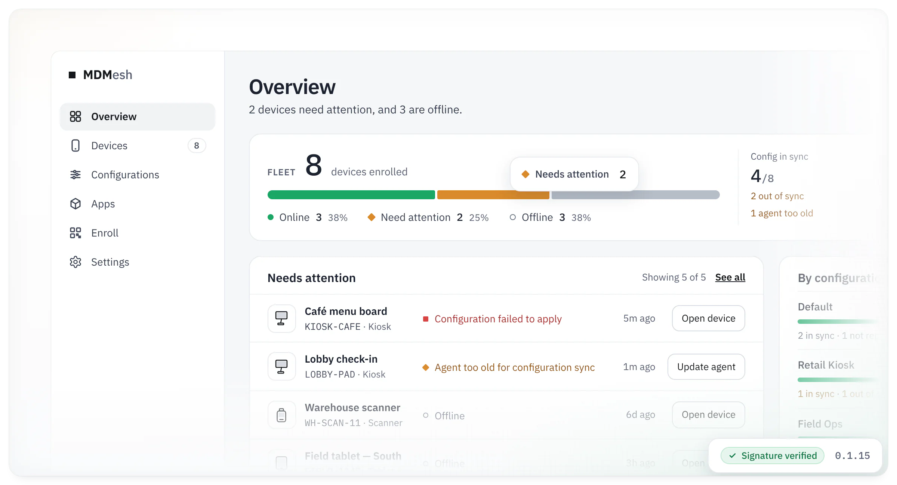
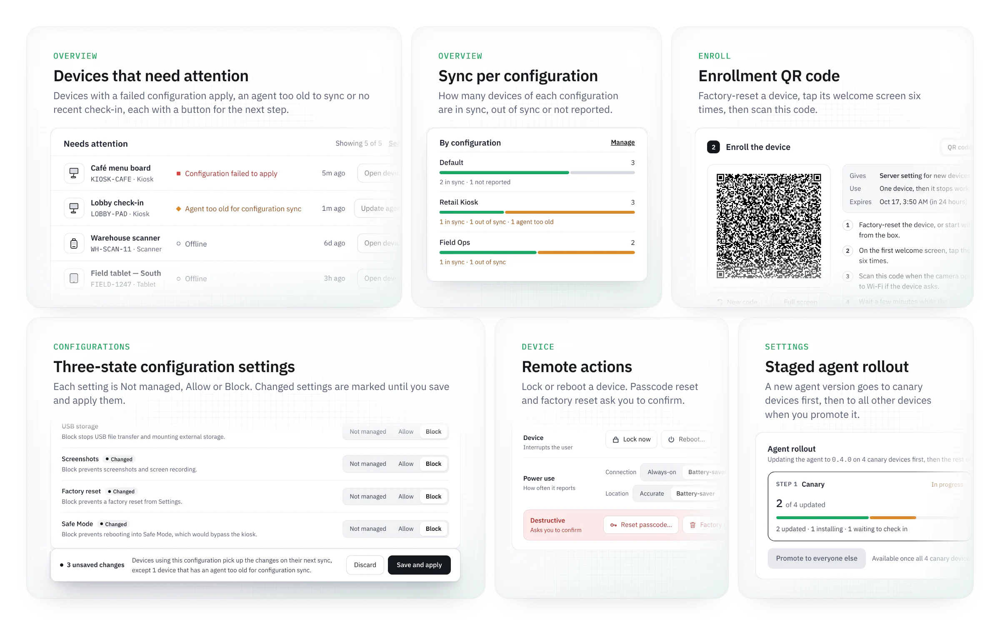
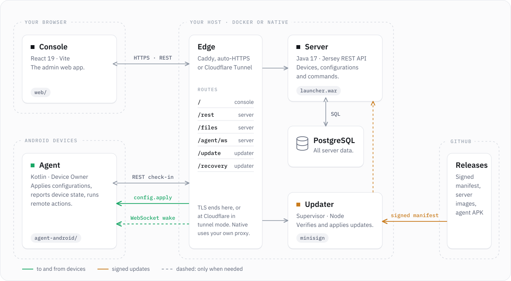

<!-- The images in docs/readme/ are generated from the console build: see scripts/readme/README.md. -->
<div align="center">

<p align="center">
<picture>
  <source media="(prefers-color-scheme: dark)" srcset="docs/readme/banner-dark.svg">
  
</picture>
</p>

**Self-hosted mobile device management (MDM) for Android: a server, a web console and a Device Owner agent.**

[](https://github.com/MDMesh-app/MDMesh/releases)
[](LICENSE)
[](CONTRIBUTING.md)


[Quick start](#-quick-start) · [Features](#-features) · [How it works](#-how-it-works) · [Install guide](DEPLOY.md) · [Architecture](#-architecture) · [Roadmap](#-roadmap)

<p align="center">
<picture>
  <source media="(prefers-color-scheme: dark)" srcset="docs/readme/hero-dark.webp">
  
</picture>
</p>

</div>

You enroll an Android device by scanning a QR code during its setup, which makes the MDMesh agent its Device Owner.
From the web console you then install apps on it, lock it into kiosk mode, see its location and send it remote
actions. The server and the agent update from signed releases.

### Why MDMesh

- **There is no paid edition.** Kiosk mode, app installs, location and the installers are all open source under
  Apache-2.0.
- **Updates are signed, and a failed update rolls back.** The updater only offers releases whose signature verifies.
  On quick-start installs you apply an update with one click. The updater backs up the database first and rolls
  back by itself if the new version fails its health check.
- **Older agents keep working after a server update.** The agent is a Device Owner app written in Kotlin. The server
  only sends it commands it reports it supports, and the agent protocol (`/agent/v1`) only ever adds fields. A test
  in CI checks this.
- **One command installs the server.** It runs on Docker Compose with automatic HTTPS (Caddy) or a Cloudflare Tunnel,
  or natively on Debian 12/13 and Ubuntu 24.04.

## ■ Features

<p align="center">
<picture>
  <source media="(prefers-color-scheme: dark)" srcset="docs/readme/features-dark.webp">
  
</picture>
</p>

- **Devices:** the device list shows each device's status, with search, filters and sorting. The Overview lists the
  devices that need attention, each with a button for the next step.
- **Device page:** tabs for remote actions, telemetry (hardware, battery, storage, network), apps, activity and
  location. The Apps tab lists the apps on the device, with search and a CSV export.
- **Configurations:** a configuration sets up to 23 device settings, from kiosk options to Wi-Fi, factory reset and
  Safe Mode. Devices apply it at their next check-in, and the device page shows the result for each setting. Apps
  added to a configuration install on its devices at their next check-in.
- **Kiosk mode:** locks a device to one app or to a grid of chosen apps, in the colours the configuration sets. Safe
  Mode is blocked in kiosk unless the configuration allows it. If the kiosk app stops, the device stays in kiosk
  and shows an "Open again" button. An exit PIN can end kiosk on the device; too many wrong PINs lock the exit for a
  while and email the administrators.
- **Apps:** add apps from your own APK uploads, from the F-Droid catalog or by link to any HTTPS host. Every install
  is checked against the app's SHA-256. The agent installs them without asking the device's user.
- **Remote actions:** send an alert or a lock-screen message, ring, lock, reboot, enter or exit kiosk mode, reset the
  passcode or factory-reset a device. Passcode reset and factory reset ask you to confirm. An alert that can't show,
  because notifications are off on the device, is reported as failed.
- **Connectivity:** by default the agent keeps its live connection only while the screen is on or the device is
  charging. A configuration can set it to Always-on, so commands reach a locked device right away.
- **Location:** a configuration sets whether devices report their last known location, a fresh GPS fix or nothing.
  The device page shows the location history on a map, for the last hour, 24 hours, 7 days or all of it.
- **Staged agent rollouts:** a new agent version goes to a set of canary devices first. You promote it to the other
  devices once the canaries have updated.
- **Sign-in and audit:** failed sign-ins are limited per address and per account. The audit log records sign-ins,
  changes and the commands sent to devices, with who did it and from where.
- **Extending:** forks add console pages, tabs and sections in `web/src/extensions/` and server plugins in
  `plugins/fork/`, without editing core files ([EXTENDING](web/EXTENDING.md)).

## ■ Quick start

On a Linux host with Docker, Docker Compose v2, `openssl` and `curl`:

```bash
bash <(curl -fsSL https://raw.githubusercontent.com/MDMesh-app/MDMesh/main/quickstart.sh)
```

This pulls the released images and sets up updates from the console. To build the images from source instead
(`setup.sh` also uses `python3` and `curl` to check the release signature for the enrollment QR):

```bash
git clone https://github.com/MDMesh-app/MDMesh.git && cd MDMesh
./setup.sh
```

Without Docker, run `sudo ./setup.sh --native` from the clone on Debian 12/13 or Ubuntu 24.04. It only needs `git`
and brings the rest ([native install](DEPLOY.md#option-c--native-no-docker)). Each installer prints the console URL
and a temporary admin password. Then enroll a device:

1. Sign in and set your own password.
2. Go to **Enroll** and generate a QR code.
3. Factory-reset an Android device (Android 7.0 or later) and tap the welcome screen six times to open the QR
   scanner.
4. Scan the code. The device enrolls as Device Owner and checks in.

On a test device you can also use `adb shell dpm set-device-owner` ([docs/DEV.md](docs/DEV.md)).

**[DEPLOY.md](DEPLOY.md)** covers the hosting modes and the native install, and
**[docs/UPGRADING.md](docs/UPGRADING.md)** covers updates.

## ■ How it works

<p align="center">
<picture>
  <source media="(prefers-color-scheme: dark)" srcset="docs/readme/how-it-works-dark.svg">
  
</picture>
</p>

1. **You edit a configuration in the console.** Each changed setting is marked "Changed" until you select **Save and
   apply**.
2. **The server wakes the devices that use the configuration** over their WebSocket connection. Each agent checks in
   and gets a `config.apply` command. A device without an open connection gets it at its next regular check-in.
3. **The agent applies each setting and reports the result for each one.** The device page shows which settings were
   applied, which failed and which the device doesn't support.

## ■ Architecture

<p align="center">
<picture>
  <source media="(prefers-color-scheme: dark)" srcset="docs/readme/architecture-dark.svg">
  
</picture>
</p>

The server is a Java (Jersey) REST API with a PostgreSQL database. In the Docker install, Caddy serves the React
console and passes API requests to the server. Caddy gets the TLS certificate, or, with a Cloudflare Tunnel,
Cloudflare handles TLS. A native install serves the console from Tomcat, behind your own TLS proxy. Agents check in
over REST and keep a WebSocket open, so the server can wake them when there's a command. The updater, a separate
service, checks GitHub Releases and verifies each release's minisign signature. On quick-start installs it also
applies the update, with a database backup and an automatic rollback. [STRUCTURE.md](STRUCTURE.md) describes the
code layout.

## ■ Roadmap

- Done: the web console, the Device Owner agent, kiosk mode, app installs, location, signed updates, staged agent
  rollouts and extensions for forks.
- Next: remote control of a device's screen (view and input) over WebRTC, with a self-hosted TURN server.
- Later: support for device makers' management APIs (Samsung Knox, Zebra) through the agent's capability layer.

## ■ Contributing

Code, docs, bug reports and ideas are all welcome. Start with **[CONTRIBUTING.md](CONTRIBUTING.md)**, then
[report a bug](https://github.com/MDMesh-app/MDMesh/issues/new?template=bug_report.yml) or
[suggest a feature](https://github.com/MDMesh-app/MDMesh/issues/new?template=feature_request.yml). For a PR, follow
the [PR template](.github/pull_request_template.md); small, focused PRs merge fastest. Report security issues
privately, as [SECURITY.md](SECURITY.md) describes.

## ■ License & credits

MDMesh is licensed under the **[Apache License 2.0](LICENSE)**. It is a fork of **[Headwind MDM](https://h-mdm.com)**
by Headwind Solutions LLC, also Apache-2.0 ([why and how: ADR-0008](docs/adr/0008-licensing-and-rebrand.md)).
Trademarks and brand names belong to their owners.

<div align="center"><sub><a href="DEPLOY.md">Install</a> · <a href="docs/UPGRADING.md">Upgrading</a> · <a href="docs/OPERATIONS.md">Operations</a> · <a href="STRUCTURE.md">Structure</a> · <a href="docs/DEV.md">Development</a> · <a href="docs/agent-architecture.md">Agent internals</a> · <a href="RELEASING.md">Releasing</a></sub></div>
