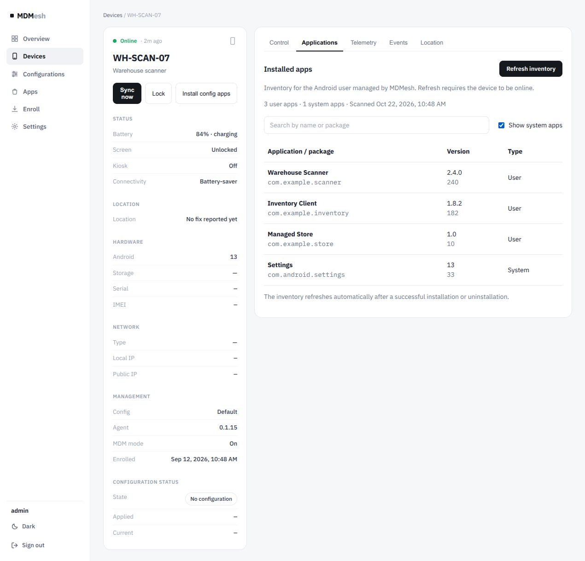

# Device application inventory

Open a device and select **Applications** to see packages installed for the Android user managed by MDMesh.
Search by label or package name; **Show system apps** includes system packages. Hidden installed packages are
included too. Packages whose data was retained after removal are excluded. This does not enumerate other Android users.

The initial list comes from the last successful full scan stored in command history. **Refresh inventory** asks
an online device for a new scan. Full inventory requires the updated agent: an older launcher-only response is
reported as an agent-update requirement, not shown as a complete list. The kiosk picker keeps its launcher-only scan.

While the tab is open, the console checks command history every five seconds. A successful `app.install` or
`app.uninstall` newer than the saved scan triggers one full scan; reopening the tab also checks for changes.
Queued or failed operations do not claim that packages changed. Manual and automatic scans do not overlap.
If a scan fails, the existing list stays visible and Refresh inventory can retry it.

Agents upload command results on a later check-in. For delivered app changes and scans, the console requests
a sync at most every 15 seconds while awaiting the result. This only wakes the device: success still requires its
actual command result. An offline device remains offline. Inventory freshness uses server timestamps, not the
browser's clock, and uses scan request time so a delayed scan acknowledgement cannot hide a later app change.

This feature only displays inventory. It does not change configuration app actions or add removal commands;
package-removal controls and user install/uninstall restriction policies are separate contributions.

## Validation

`cd web && npm run test:inventory && npm run build`

Agent protocol tests cover the optional full-scan flag and old response defaults. Browser checks cover cached
inventory, search/system filters, pending versus successful package changes, one scan per successful change,
returning to the tab, and results withheld until a sync. Installation/removal and the faster result flow were
also exercised on a physical device using the downstream integration branch.
